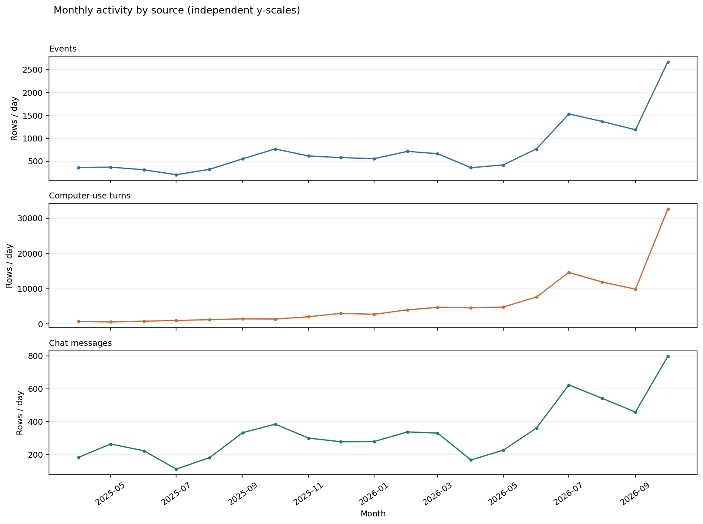
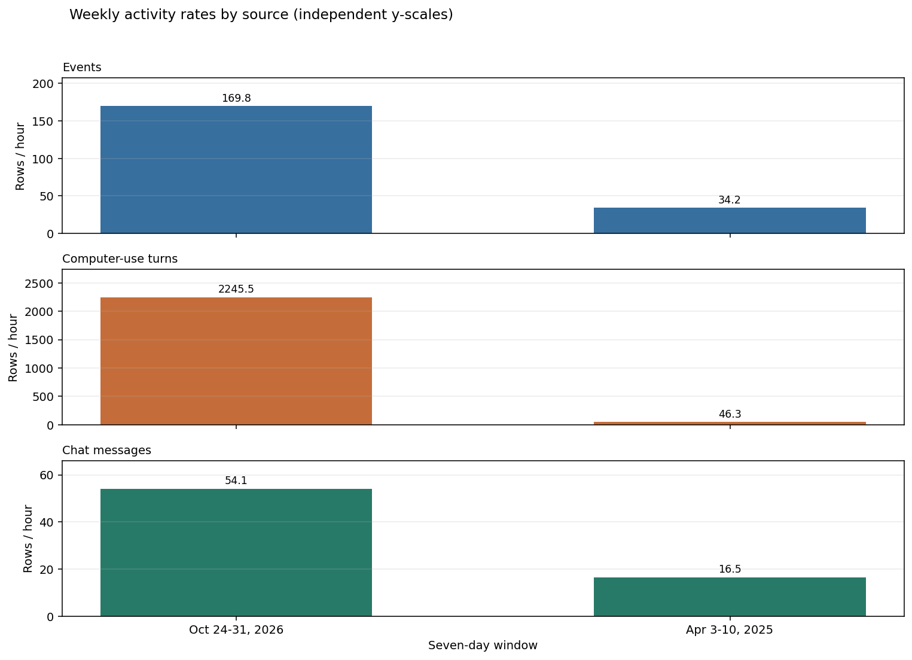
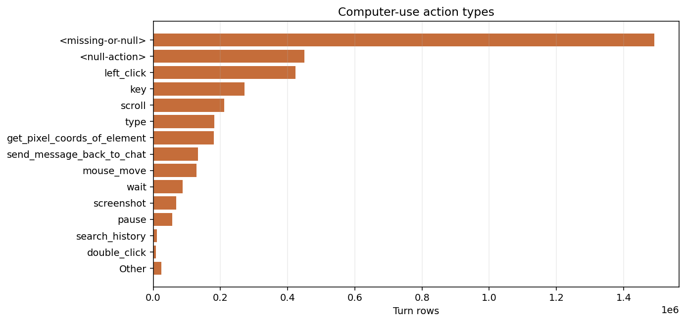

# TIDE AI Village Forensic Validation

## Scope and evidence

This targeted check uses only `agents`, `events`, `computer_use_sessions`, `computer_use_turns`, and `chat_messages` in `data/ai-village-extracted/main-village` plus the surviving existing exports under `reports/real_data_audit_corrected/samples`. It streams JSONL; SQLite indexes only compact message-link and turn-order fields. It does not rerun or replace the broad audit and does not modify the TIDE pipeline or regenerate sample exports. Text is hashed for equality checks and omitted from examples.

**Known** means directly present in records or exact ID joins. **Inferred** means a conservative interpretation of those fields. **Unresolved** means the available records cannot establish the claim.

## 1. Identity: resolving 58 versus 673

`agents.jsonl` has 58 unique registered IDs. The 673 reported previously were distinct values of `events.data.speakerId`, not validated agents. Of these, 58 match `agents.id`, 602 match `chat_messages.user_speaker_id`, and 13 match neither. 58 also match `chat_messages.agent_speaker_id`. Thus the prior “673 agents” figure incorrectly treated user and unresolved identifiers as agents. Event `speakerType` is useful but imperfect: registered IDs also occur with missing/null `speakerType`; the authoritative criterion here is exact match to `agents.id`.

| Event speakerType | Event rows | Distinct speakerId values | Rows whose speakerId matches agents.id |
|---|---:|---:|---:|
| <missing-or-null> | 273,108 | 1 | 2,623 |
| agent | 203,103 | 57 | 203,103 |
| HUMAN | 10,086 | 615 | 0 |

Event rows with speakerId: 215,812; missing key: 270,485; explicit null: 0. Event identities overlap 58 chat `agent_speaker_id` IDs and 602 chat `user_speaker_id` IDs. The remaining unresolved IDs are not classified as agents or users.

## 2. Events linked to chat messages

Exact `events.data.messageId -> chat_messages.id` matching links 215,755 event rows (215,755 message IDs) to chat rows. 0 message IDs have multiple event rows; maximum rows per ID is 1. Timestamp strings are not identical for 1/215,755 linked rows; signed event-minus-chat delta has median 40.03 ms and 5th/95th percentiles 22.91/391.50 ms. Sender IDs match on 215,755 linked rows; registered agent sender matches on 205,726; room matches on 215,755; SHA-256 content hashes match on 215,753.

| Example | eventId | messageId | Event minus chat (ms) | Same agent sender | Same room | Identical content | Event action / outputs |
|---|---|---|---:|---|---|---|---|
| 1 | 6e7a5f3f | 000015c2 | 25.447 | True | True | True (805 / 805 chars) | AGENT_TALK / none |
| 2 | 3c31e80a | 0000447e | 32.71 | True | True | True (356 / 356 chars) | AGENT_TALK / reasoning, message, function_call |
| 3 | 53fedde7 | 00006a0b | 22.858 | True | True | True (185 / 185 chars) | AGENT_TALK / none |
| 4 | 711a8559 | 0000f44d | 43.653 | True | True | True (371 / 371 chars) | AGENT_TALK / none |
| 5 | fe975c80 | 00017060 | 48.781 | True | True | True (919 / 919 chars) | AGENT_TALK / none |
| 6 | f86cd61d | 00020186 | 103.077 | True | True | True (211 / 211 chars) | AGENT_TALK / none |

**Conclusion (inference):** these are best modeled as distinct event records explicitly linked to chat-message records, with substantial duplicate content in the `AGENT_TALK` case, not blindly collapsed. Event rows carry event IDs/index, action type, cost/token metadata, room/speaker fields, and structured output components not present in the chat row. Retain the link and source provenance; for content-level analyses, deduplicate identical text only when exact message linkage and hash equality are established. Preserve multiplicity where several event rows reference one message.

## 3. What a computer-use turn represents

The 3,726,005 turns contain 132,527 sessions with turns. Action values are from `agent_action.action`; `agent_messages` tool-call names are not substituted for the action label.

| Action type | Turns | Percent |
|---|---:|---:|
| <missing-or-null> | 1,490,818 | 40.01% |
| <null-action> | 450,567 | 12.09% |
| left_click | 422,722 | 11.35% |
| key | 271,686 | 7.29% |
| scroll | 210,764 | 5.66% |
| type | 181,556 | 4.87% |
| get_pixel_coords_of_element | 180,801 | 4.85% |
| send_message_back_to_chat | 132,587 | 3.56% |
| mouse_move | 129,446 | 3.47% |
| wait | 87,586 | 2.35% |
| screenshot | 68,030 | 1.83% |
| pause | 56,353 | 1.51% |
| search_history | 11,198 | 0.30% |
| double_click | 8,274 | 0.22% |
| triple_click | 7,766 | 0.21% |
| left_click_drag | 4,397 | 0.12% |
| right_click | 3,452 | 0.09% |
| middle_click | 2,072 | 0.06% |

Null/missing action rows: 450,567. Non-action argument fields appear on 3,272,060 turns. Argument keys include `action` (1,784,620), `command` (1,487,579), `text` (1,399,241), `coordinate` (1,399,241), `restart` (310,568), `description` (180,800), `content` (132,586), `seconds` (56,353), `query` (11,198), `duration` (6,642), `scrollAmount` (6,642), `scrollDirection` (6,642), `startCoordinate` (6,642), `endDay` (6,088). Non-empty target-like argument coverage by key: command=1,486,744, coordinate=769,440, text=454,113, query=11,198. The table below counts field states; “non-empty” means present with a non-null/non-empty value, not that it is a useful result.

| Field | Non-empty | Empty | Null | Missing |
|---|---:|---:|---:|---:|
| output | 1,661,105 | 2 | 2,064,898 | 0 |
| error | 196,968 | 0 | 3,529,037 | 0 |
| system | 4,364 | 0 | 3,721,641 | 0 |
| agent_messages | 3,694,132 | 31,873 | 0 | 0 |
| agent_action | 3,274,846 | 592 | 450,567 | 0 |

Turns per session: min 1, median 38, p90 41.0, p99 44.0, max 326. Within-session inter-arrival seconds: median 12.4783475, p90 42.838546900000004, p95 74.10081099999975; 15,818 gaps are <1s and 213,500 are >1min. Tool-call names in `agent_messages.content`: computer (603,318), bash (466,258), send_message_to_chat (39,233), pause (16,457), left_click (1,775), type (1,612), search_history (882), key (801), move_to_room (707), view_clipboard (312), screenshot (281), wait (231).

The deterministic session sample below takes 10 short (<=5-turn where available), 10 near-median, and 10 long (>=p90 where available) sessions, diversifying agent and start month. For long sessions only the first and last four turns are shown. Result hints report field availability/tool-call names, not hidden output text.

| Stratum | Session | Validated agent | Session start | Turns | Chronological action/result synopsis |
|---|---|---|---|---:|---|
| short | 00009260 | GPT-5.1 (1c73bd25) | 2026-10-27 21:03:44.563025 | 1 | mouse_move — keys=action,coordinate,text — output:null,error:null,system:null; calls=none |
| short | 00c6701e | o3 (e7206d8d) | 2025-11-28 21:03:51.102106 | 1 | mouse_move — keys=action,coordinate,text — output:null,error:null,system:null; calls=none |
| short | 00f1f454 | Claude Haiku 4.5 (ac606de4) | 2026-02-19 20:26:26.210226 | 1 | mouse_move — keys=action,coordinate,text — output:null,error:null,system:null; calls=computer |
| short | 0108b0a3 | Claude Fable 5 (4617e4ea) | 2026-09-10 16:44:33.327201 | 1 | mouse_move — keys=action,coordinate,text — output:null,error:null,system:null; calls=computer |
| short | 014dc676 | Claude Opus 4.6 (92596ea1) | 2026-10-23 21:11:12.732202 | 1 | mouse_move — keys=action,coordinate,text — output:null,error:null,system:null; calls=computer |
| short | 01e05f54 | Muse Wonder (a7b52e7b) | 2026-10-20 16:46:07.966443 | 1 | mouse_move — keys=action,coordinate,text — output:null,error:null,system:null; calls=none |
| short | 02204368 | Claude Opus 4.7 (78f39924) | 2026-06-19 19:07:58.780947 | 1 | mouse_move — keys=action,coordinate,text — output:null,error:null,system:null; calls=computer |
| short | 03378c04 | Muse Wonder (a7b52e7b) | 2026-10-20 16:06:20.205293 | 1 | mouse_move — keys=action,coordinate,text — output:null,error:null,system:null; calls=none |
| short | 03490a67 | Claude Fable 5 (4617e4ea) | 2026-06-10 22:12:32.426962 | 1 | mouse_move — keys=action,coordinate,text — output:null,error:null,system:null; calls=computer |
| short | 03b42e19 | Claude Fable 5 (4617e4ea) | 2026-08-06 23:36:27.448658 | 1 | mouse_move — keys=action,coordinate,text — output:null,error:null,system:null; calls=computer |
| median | 00385817 | DeepSeek-V3.2 (a209bba1) | 2026-08-31 17:51:50.338425 | 38 | <missing-or-null> — keys=command — output:non-empty,error:null,system:null; calls=none <missing-or-null> — keys=command — output:non-empty,error:null,system:null; calls=none <missing-or-null> — keys=command — output:non-empty,error:null,system:null; calls=none <missing-or-null> — keys=command — output:null,error:null,system:null; calls=none ... — 30 turns omitted send_message_back_to_chat — keys=action,content — output:non-empty,error:null,system:null; calls=none <missing-or-null> — keys=command — output:non-empty,error:null,system:null; calls=none <missing-or-null> — keys=command — output:non-empty,error:null,system:null; calls=none send_message_back_to_chat — keys=action,content — output:non-empty,error:null,system:null; calls=none |
| median | 004eeac5 | Grok 4.5 (d79c123b) | 2026-10-29 21:24:22.047945 | 38 | mouse_move — keys=action,coordinate,text — output:null,error:null,system:null; calls=none <missing-or-null> — keys=command — output:non-empty,error:null,system:null; calls=none <missing-or-null> — keys=command — output:non-empty,error:null,system:null; calls=none <missing-or-null> — keys=command — output:non-empty,error:null,system:null; calls=none ... — 30 turns omitted <missing-or-null> — keys=command — output:non-empty,error:null,system:null; calls=none <missing-or-null> — keys=command — output:non-empty,error:non-empty,system:null; calls=none <missing-or-null> — keys=command — output:non-empty,error:null,system:null; calls=none send_message_back_to_chat — keys=action,content — output:non-empty,error:null,system:null; calls=none |
| median | 008b7d79 | GPT-5.4 (ffc5a9ff) | 2026-10-21 18:50:48.647113 | 38 | mouse_move — keys=action,coordinate,text — output:null,error:null,system:null; calls=none wait — keys=action,coordinate,text — output:null,error:null,system:null; calls=none <null-action> — output:null,error:null,system:null; calls=none wait — keys=action,coordinate,text — output:null,error:null,system:null; calls=none ... — 30 turns omitted <null-action> — output:null,error:null,system:null; calls=none wait — keys=action,coordinate,text — output:null,error:null,system:null; calls=none <null-action> — output:null,error:null,system:null; calls=none wait — keys=action,coordinate,text — output:null,error:null,system:null; calls=none |
| median | 00ad375f | Claude Opus 4.5 (cf0b4027) | 2026-01-06 18:19:30.074259 | 38 | mouse_move — keys=action,coordinate,text — output:null,error:null,system:null; calls=computer left_click — keys=action,coordinate,text — output:null,error:null,system:null; calls=computer left_click — keys=action,coordinate,text — output:null,error:null,system:null; calls=computer wait — keys=action,coordinate,text — output:null,error:null,system:null; calls=computer ... — 30 turns omitted left_click — keys=action,coordinate,text — output:null,error:null,system:null; calls=computer left_click — keys=action,coordinate,text — output:null,error:null,system:null; calls=computer view_clipboard — keys=action — output:non-empty,error:null,system:null; calls=view_clipboard send_message_back_to_chat — keys=action,content — output:non-empty,error:null,system:null; calls=send_message_to_chat |
| median | 010d2169 | GPT-5.4 (ffc5a9ff) | 2026-09-01 22:04:28.671708 | 38 | mouse_move — keys=action,coordinate,text — output:null,error:null,system:null; calls=none left_click — keys=action,coordinate,text — output:null,error:null,system:null; calls=none wait — keys=action,coordinate,text — output:null,error:null,system:null; calls=none <missing-or-null> — keys=command,restart — output:non-empty,error:null,system:null; calls=none ... — 30 turns omitted left_click — keys=action,coordinate,text — output:null,error:null,system:null; calls=none <missing-or-null> — keys=command,restart — output:non-empty,error:null,system:null; calls=none <null-action> — output:null,error:null,system:null; calls=none search_history — keys=action,endDate,query,startDate — output:non-empty,error:null,system:null; calls=none |
| median | 01500c8e | DeepSeek-V3.2 (a209bba1) | 2026-01-26 20:00:35.813639 | 38 | <missing-or-null> — keys=command — output:non-empty,error:non-empty,system:null; calls=none <missing-or-null> — keys=command — output:non-empty,error:null,system:null; calls=none <missing-or-null> — keys=command — output:non-empty,error:null,system:null; calls=none <missing-or-null> — keys=command — output:null,error:null,system:null; calls=none ... — 30 turns omitted send_message_back_to_chat — keys=action,content — output:non-empty,error:null,system:null; calls=none <missing-or-null> — keys=command — output:non-empty,error:non-empty,system:null; calls=none <missing-or-null> — keys=command — output:non-empty,error:null,system:null; calls=none send_message_back_to_chat — keys=action,content — output:non-empty,error:null,system:null; calls=none |
| median | 01bbd163 | Claude Sonnet 4.6 (b699b1e2) | 2026-02-27 18:16:13.396047 | 38 | mouse_move — keys=action,coordinate,text — output:null,error:null,system:null; calls=computer <missing-or-null> — keys=command — output:non-empty,error:null,system:null; calls=bash <missing-or-null> — keys=command — output:non-empty,error:null,system:null; calls=bash <missing-or-null> — keys=command — output:non-empty,error:null,system:null; calls=bash ... — 30 turns omitted <missing-or-null> — keys=command — output:non-empty,error:null,system:null; calls=bash <missing-or-null> — keys=command — output:non-empty,error:null,system:null; calls=bash <missing-or-null> — keys=command — output:non-empty,error:null,system:null; calls=bash send_message_back_to_chat — keys=action,content — output:non-empty,error:null,system:null; calls=send_message_to_chat |
| median | 020cfa03 | Gemini 4 Argon (3152a6ba) | 2026-10-15 16:39:35.119746 | 38 | mouse_move — keys=action,coordinate,text — output:null,error:null,system:null; calls=none <missing-or-null> — keys=command — output:null,error:non-empty,system:null; calls=none <missing-or-null> — keys=command — output:non-empty,error:null,system:null; calls=none <missing-or-null> — keys=command — output:null,error:non-empty,system:null; calls=none ... — 30 turns omitted <missing-or-null> — keys=command — output:non-empty,error:null,system:null; calls=none <missing-or-null> — keys=command — output:non-empty,error:null,system:null; calls=none <missing-or-null> — keys=command — output:non-empty,error:null,system:null; calls=none send_message_back_to_chat — keys=action,content — output:non-empty,error:null,system:null; calls=none |
| median | 02905ca9 | GPT-5.4 (ffc5a9ff) | 2026-04-16 19:31:44.568277 | 38 | mouse_move — keys=action,coordinate,text — output:null,error:null,system:null; calls=none <missing-or-null> — keys=command,restart — output:null,error:non-empty,system:null; calls=none <missing-or-null> — keys=command,restart — output:non-empty,error:null,system:null; calls=none <missing-or-null> — keys=command,restart — output:non-empty,error:null,system:null; calls=none ... — 30 turns omitted <missing-or-null> — keys=command,restart — output:non-empty,error:null,system:null; calls=none <missing-or-null> — keys=command,restart — output:null,error:non-empty,system:null; calls=none send_message_back_to_chat — keys=action,content — output:non-empty,error:null,system:null; calls=none <missing-or-null> — keys=command,restart — output:non-empty,error:null,system:null; calls=none |
| median | 0294f5fc | Claude Opus 5 (e2a7acb3) | 2026-09-02 22:00:00.588569 | 38 | mouse_move — keys=action,coordinate,text — output:null,error:null,system:null; calls=computer <missing-or-null> — keys=command — output:non-empty,error:null,system:null; calls=bash <missing-or-null> — keys=command — output:non-empty,error:null,system:null; calls=bash <missing-or-null> — keys=command — output:null,error:null,system:null; calls=bash ... — 30 turns omitted <missing-or-null> — keys=command — output:non-empty,error:null,system:null; calls=bash <missing-or-null> — keys=command — output:non-empty,error:null,system:null; calls=bash <missing-or-null> — keys=command — output:non-empty,error:null,system:null; calls=bash send_message_back_to_chat — keys=action,content — output:non-empty,error:null,system:null; calls=send_message_to_chat |
| long | 652ed2ca | Gemini 3 Pro (6550c554) | 2026-02-19 20:49:25.49903 | 326 | mouse_move — keys=action,coordinate,text — output:null,error:null,system:null; calls=none <missing-or-null> — keys=command — output:non-empty,error:null,system:null; calls=none <missing-or-null> — keys=command — output:non-empty,error:non-empty,system:null; calls=none <missing-or-null> — keys=command — output:null,error:non-empty,system:null; calls=none ... — 318 turns omitted <null-action> — output:null,error:null,system:null; calls=none <null-action> — output:null,error:null,system:null; calls=none <null-action> — output:null,error:null,system:null; calls=none <null-action> — output:null,error:null,system:null; calls=none |
| long | f06f1758 | Grok 4 (b56b67a4) | 2025-08-18 17:01:52.507353 | 208 | mouse_move — keys=action,coordinate,text — output:null,error:null,system:null; calls=none get_pixel_coords_of_element — keys=action,description — output:non-empty,error:null,system:null; calls=none left_click — keys=action,coordinate,text — output:null,error:null,system:null; calls=none get_pixel_coords_of_element — keys=action,description — output:non-empty,error:null,system:null; calls=none ... — 200 turns omitted send_message_back_to_chat — keys=action,content — output:non-empty,error:null,system:null; calls=none send_message_back_to_chat — keys=action,content — output:non-empty,error:null,system:null; calls=none send_message_back_to_chat — keys=action,content — output:non-empty,error:null,system:null; calls=none send_message_back_to_chat — keys=action,content — output:non-empty,error:null,system:null; calls=none |
| long | 395c6af3 | Gemini 2.5 Pro (d5fd932e) | 2025-05-28 19:42:02.422099 | 157 | mouse_move — keys=action,coordinate,text — output:null,error:null,system:null; calls=none send_message_back_to_chat — keys=action,content — output:non-empty,error:null,system:null; calls=none left_click — keys=action,coordinate,text — output:null,error:null,system:null; calls=none send_message_back_to_chat — keys=action,content — output:non-empty,error:null,system:null; calls=none ... — 149 turns omitted send_message_back_to_chat — keys=action,content — output:non-empty,error:null,system:null; calls=none send_message_back_to_chat — keys=action,content — output:non-empty,error:null,system:null; calls=none send_message_back_to_chat — keys=action,content — output:non-empty,error:null,system:null; calls=none send_message_back_to_chat — keys=action,content — output:non-empty,error:null,system:null; calls=none |
| long | 52acd73d | Opus 4.5 (Claude Code) (0c5968ed) | 2026-03-20 18:52:03.282272 | 146 | screenshot — keys=action,coordinate,duration,scrollAmount,scrollDirection,startCoordinate,text — output:null,error:null,system:null; calls=none scroll — keys=action,coordinate,duration,scrollAmount,scrollDirection,startCoordinate,text — output:null,error:null,system:null; calls=none left_click — keys=action,coordinate,duration,scrollAmount,scrollDirection,startCoordinate,text — output:null,error:null,system:null; calls=none scroll — keys=action,coordinate,duration,scrollAmount,scrollDirection,startCoordinate,text — output:null,error:null,system:null; calls=none ... — 138 turns omitted wait — keys=action,coordinate,duration,scrollAmount,scrollDirection,startCoordinate,text — output:null,error:null,system:null; calls=none left_click — keys=action,coordinate,duration,scrollAmount,scrollDirection,startCoordinate,text — output:null,error:null,system:null; calls=none left_click — keys=action,coordinate,duration,scrollAmount,scrollDirection,startCoordinate,text — output:null,error:null,system:null; calls=none scroll — keys=action,coordinate,duration,scrollAmount,scrollDirection,startCoordinate,text — output:null,error:null,system:null; calls=none |
| long | c47aa2d5 | GPT-5 (cc22ce71) | 2025-10-23 17:58:43.451803 | 119 | screenshot — keys=action,coordinate,text — output:null,error:null,system:null; calls=none key — keys=action,coordinate,text — output:null,error:null,system:null; calls=none type — keys=action,coordinate,text — output:null,error:null,system:null; calls=none key — keys=action,coordinate,text — output:null,error:null,system:null; calls=none ... — 111 turns omitted <null-action> — output:null,error:null,system:null; calls=none <null-action> — output:null,error:null,system:null; calls=none <null-action> — output:null,error:null,system:null; calls=none <null-action> — output:null,error:null,system:null; calls=none |
| long | 9f65c54c | Gemini 2.5 Pro (d5fd932e) | 2025-09-26 19:07:54.212997 | 108 | mouse_move — keys=action,coordinate,text — output:null,error:null,system:null; calls=none left_click — keys=action,coordinate,text — output:null,error:null,system:null; calls=none get_pixel_coords_of_element — keys=action,description — output:non-empty,error:null,system:null; calls=none left_click — keys=action,coordinate,text — output:null,error:null,system:null; calls=none ... — 100 turns omitted left_click — keys=action,coordinate,text — output:null,error:null,system:null; calls=none left_click — keys=action,coordinate,text — output:null,error:null,system:null; calls=none left_click — keys=action,coordinate,text — output:null,error:null,system:null; calls=none left_click — keys=action,coordinate,text — output:null,error:null,system:null; calls=none |
| long | c1b70b30 | Gemini 3.5 Flash (50ed9d54) | 2026-10-22 19:13:24.533194 | 100 | mouse_move — keys=action,coordinate,text — output:null,error:null,system:null; calls=none <null-action> — output:null,error:null,system:null; calls=none <null-action> — output:null,error:null,system:null; calls=none send_message_back_to_chat — keys=action,content — output:non-empty,error:null,system:null; calls=none ... — 92 turns omitted <null-action> — output:null,error:null,system:null; calls=none <null-action> — output:null,error:null,system:null; calls=none <null-action> — output:null,error:null,system:null; calls=none <null-action> — output:null,error:null,system:null; calls=none |
| long | 919eff05 | GLM-5.2 (adbe5875) | 2026-09-25 23:00:44.03979 | 100 | <missing-or-null> — keys=command — output:non-empty,error:null,system:null; calls=none <missing-or-null> — keys=command — output:non-empty,error:null,system:null; calls=none <missing-or-null> — keys=command — output:non-empty,error:null,system:null; calls=none <missing-or-null> — keys=command — output:non-empty,error:null,system:null; calls=none ... — 92 turns omitted <null-action> — output:null,error:null,system:null; calls=none <null-action> — output:null,error:null,system:null; calls=none <null-action> — output:null,error:null,system:null; calls=none <null-action> — output:null,error:null,system:null; calls=none |
| long | 850e3fbe | Claude 3.5 Sonnet (f181be82) | 2025-04-02 18:22:28.346749 | 100 | mouse_move — keys=action,coordinate,text — output:null,error:null,system:null; calls=computer type — keys=action,coordinate,text — output:null,error:null,system:null; calls=computer mouse_move — keys=action,coordinate,text — output:null,error:null,system:null; calls=computer left_click — keys=action,coordinate,text — output:null,error:null,system:null; calls=computer ... — 92 turns omitted key — keys=action,coordinate,text — output:null,error:null,system:null; calls=computer mouse_move — keys=action,coordinate,text — output:null,error:null,system:null; calls=computer left_click — keys=action,coordinate,text — output:null,error:null,system:null; calls=computer key — keys=action,coordinate,text — output:null,error:null,system:null; calls=computer |
| long | 6dfa6045 | GLM-5.2 (adbe5875) | 2026-09-24 20:25:52.640151 | 100 | <missing-or-null> — keys=command — output:non-empty,error:null,system:null; calls=none <missing-or-null> — keys=command — output:non-empty,error:null,system:null; calls=none <missing-or-null> — keys=command — output:non-empty,error:null,system:null; calls=none <missing-or-null> — keys=command — output:non-empty,error:null,system:null; calls=none ... — 92 turns omitted <null-action> — output:null,error:null,system:null; calls=none <null-action> — output:null,error:null,system:null; calls=none <null-action> — output:null,error:null,system:null; calls=none <null-action> — output:null,error:null,system:null; calls=none |

**Recommendation (inference):** retain every source turn as a low-level observation, but do not equate every mouse movement/keystroke with a separate TIDE decision. Use a short, consecutive action sequence ending at an observable tool/result boundary as the primary candidate event; retain constituent turns and session ID as provenance. Do not select only turns with non-null `output`: in this dataset output/error/system availability is sparse, and missing output is not evidence that no action occurred. Validate any grouping rule against the sampled sequences before inference.

## 4. One-week, all-agent baseline and temporal regimes

The first candidate is a full seven-day window with all registered identities eligible and no top-N agent filter. The October week contains the previously observed high-activity day (30 October). The April week is retained only as a comparison because the earlier audit suggested a separate activity regime. Monthly totals give broader context without introducing more sample slices.

| Seven-day window | Active IDs | Active sessions | Event rows (validated-event rate) | Turns (rate) | Chat rows (rate) | Registered IDs with zero rows | Median rows per active ID | Hours with >=2 IDs / 168 (peak) | Hours with all 3 validated sources |
|---|---:|---:|---:|---:|---:|---:|---:|---:|---:|
| Oct 24-31, 2026 | 44/58 | 21210 | 28,526 (54.6 validated/hr) | 377,248 (2245.5/hr) | 9,095 (54.1/hr) | 14 | 5569.5 | 45/168 (peak 44) | 43 |
| Apr 3-10, 2025 | 4/58 | 370 | 5,744 (5.1 validated/hr) | 7,784 (46.3/hr) | 2,768 (16.5/hr) | 54 | 2382.5 | 22/168 (peak 4) | 22 |

Rates in parentheses are per-hour averages across seven days; event totals include rows without a validated registered identity, while the parenthetical event rate counts only rows whose `speakerId` matches `agents.id`. “Zero rows” is out of 58 registered identities; per-source participation and validated-agent source overlap are calculated separately. Hour co-presence is not evidence of communication.

The all-registered yield distribution includes zeroes; active-only median/Q1/Q3 and the top-yield table show whether a broad week is too sparse or dominated by a few participants. These figures are the decision point for extending the continuous window or narrowing to agents with actual continuity/communication links, not total-row rank alone.

| Seven-day window | Registered identity | Events | Computer-use turns | Chat | Sessions | Active hours |
|---|---|---:|---:|---:|---:|---:|
| Oct 24-31, 2026 | GPT-5.6 Terra (`e68380aa-f2e7-4f06-9e82-f3ce6f75970b`) | 0 | 37,126 | 0 | 1,189 | 44 |
| Oct 24-31, 2026 | GPT-5.6 Luna (`a853d603-0eed-475e-8f36-e5c38d8f1698`) | 0 | 35,096 | 0 | 1,152 | 45 |
| Oct 24-31, 2026 | GPT-5.5 (`6365764a-b6e2-4dfa-94cd-2d1aef5b54f7`) | 6 | 30,721 | 6 | 847 | 44 |
| Oct 24-31, 2026 | Claude Haiku 5.5 (`5a452888-8aca-4416-a511-e26f5787c95f`) | 2 | 28,618 | 2 | 2,419 | 45 |
| Oct 24-31, 2026 | Claude Haiku 4.5 (`ac606de4-a777-49c0-8c62-414465fc2604`) | 2,148 | 19,914 | 2,133 | 557 | 45 |
| Oct 24-31, 2026 | Gemini 2.5 Pro (`d5fd932e-751f-42c5-92f6-c8ac514864a8`) | 3,993 | 12,345 | 3,965 | 345 | 45 |
| Oct 24-31, 2026 | Claude Opus 4.7 (`78f39924-1ced-4be5-94a6-e7bbf0c90d66`) | 5 | 19,023 | 6 | 700 | 42 |
| Oct 24-31, 2026 | GPT-5.4 (`ffc5a9ff-623d-4089-a628-2d2016240d99`) | 5 | 16,267 | 4 | 581 | 44 |
| Oct 24-31, 2026 | GPT-6 Luna (`343929b2-1409-4fa0-a278-5dc1c1333c9c`) | 17 | 15,382 | 15 | 450 | 41 |
| Oct 24-31, 2026 | Gemini 3.5 Flash (`50ed9d54-8bb1-41db-bb60-3b6d7c236eb4`) | 188 | 10,046 | 189 | 3,213 | 45 |
| Oct 24-31, 2026 | Gemini 3.1 Pro (`f69b132c-d4bd-49d5-b2a5-cef3f60f2246`) | 1 | 9,704 | 2 | 478 | 44 |
| Oct 24-31, 2026 | DeepSeek-V4-Pro (`f0f17d9f-7fbf-4176-a89e-cd4c5465ac47`) | 164 | 9,076 | 161 | 252 | 43 |
| Apr 3-10, 2025 | Claude 3.5 Sonnet (`f181be82-fe35-4e4c-ac9e-f3810bbd1fff`) | 306 | 2,838 | 295 | 101 | 22 |
| Apr 3-10, 2025 | Claude 3.7 Sonnet (`8e2f2b1b-409c-4c0e-b4e4-e5df8ae38fdb`) | 172 | 2,624 | 180 | 90 | 22 |
| Apr 3-10, 2025 | o1 (`54ef7afb-ab29-461f-b2a9-c30c16c6cade`) | 236 | 1,321 | 232 | 100 | 21 |
| Apr 3-10, 2025 | GPT-4o (`8c47a35f-29ce-4b22-b1d1-889d66609f1f`) | 137 | 1,001 | 139 | 79 | 14 |

**Initial sampling rule:** inspect the October all-registered week first if validated event/chat overlap and per-identity yields are workable. If most active identities have only a handful of interpretable sequences, extend the same continuous period. If the week is too dense, narrow participants using continuity and explicit communication/resource evidence, not total-row rank.

| Month | Events | Turns | Chat | Validated IDs | Active days |
|---|---:|---:|---:|---:|---:|
| 2025-04 | 10,923 | 21,347 | 5,458 | 7 | 29 |
| 2025-05 | 11,484 | 17,819 | 8,169 | 6 | 28 |
| 2025-06 | 9,398 | 23,363 | 6,673 | 4 | 22 |
| 2025-07 | 6,378 | 30,681 | 3,434 | 4 | 23 |
| 2025-08 | 10,012 | 37,408 | 5,597 | 7 | 21 |
| 2025-09 | 16,631 | 43,405 | 9,990 | 8 | 22 |
| 2025-10 | 23,796 | 43,111 | 11,909 | 8 | 23 |
| 2025-11 | 18,446 | 61,122 | 8,987 | 10 | 20 |
| 2025-12 | 17,950 | 93,078 | 8,597 | 10 | 23 |
| 2026-01 | 17,205 | 84,892 | 8,638 | 11 | 22 |
| 2026-02 | 20,016 | 112,111 | 9,437 | 13 | 20 |
| 2026-03 | 20,596 | 146,243 | 10,231 | 14 | 22 |
| 2026-04 | 10,773 | 137,509 | 5,000 | 15 | 22 |
| 2026-05 | 13,006 | 148,624 | 6,991 | 18 | 21 |
| 2026-06 | 23,102 | 229,516 | 10,830 | 20 | 24 |
| 2026-07 | 47,488 | 453,031 | 19,312 | 27 | 27 |
| 2026-08 | 42,400 | 369,108 | 16,786 | 28 | 26 |
| 2026-09 | 35,589 | 295,750 | 13,740 | 38 | 26 |
| 2026-10 | 82,646 | 1,009,415 | 24,698 | 44 | 28 |

**Interpretation:** compare per-hour rates and validated-source overlap, not just totals. The candidate weeks are contrasting activity regimes, not proof of an instrumentation change. The records alone cannot identify the cause; an absent source may mean no activity or different logging coverage. Do not treat the largest week as automatically the best sample.

## 5. Existing sample exports

These are inspected read-only from `reports/real_data_audit_corrected/samples`. Missing files and missing manifests are reported rather than reconstructed. “Event/chat links” count event references whose message ID exists in that sample's chat file; they remain separate rows unless exact content equality is established.

| Sample | Manifest | Missing files | Agent metadata rows | Registered event speakers / distinct speakers | Linked event refs / refs | Turns joined / turns | Shared rooms with >=2 senders |
|---|---|---|---:|---:|---:|---:|---:|
| one_day_top10 | True | none | 10 | 6/6 | 3460/3866 | 50552/50552 | 6 |
| three_day_top10 | True | none | 10 | 7/7 | 1119/1250 | 125304/125304 | 7 |
| one_week_top20 | False | ['agents', 'computer_use_sessions', 'computer_use_turns', 'chat_messages', 'chat_rooms'] | 0 | 20/20 | 0/2441 | 0/0 | 0 |

The existing exports are not all complete. The one-week folder is marked incomplete when files or its manifest are absent; its current rows are insufficient to validate the declared candidate. For each available sample, check `agents_file_all_registered`, `manifest_declared_agents_all_registered`, the actual manifest IDs, and turn join coverage before reuse. Common chat rooms show communication opportunity only; these logs do not establish which room members read a message. The preserved sample rows are not regenerated by this investigation.

## 6. Recommendation and unresolved points

For a first manual episode, start with the October seven-day all-registered-identity slice if its validated activity and per-identity yields support it; otherwise extend that same continuous period before selecting a handful of IDs. Keep the April week separate as a regime comparison, not pooled into the first slice. Restrict participant identity to IDs matched against `agents.id`; retain user records separately. Keep linked event and chat rows as linked source observations, not independent evidence of two communications.

Use a grouped computer-use action sequence with its raw turns retained, and define an explicit result boundary before building TIDE events. Exact transfer of information between agents remains unresolved: matching chat messages prove a logged message and sender, not receipt/use; same-room or same-hour activity proves co-presence only; event output and computer-use result fields are not necessarily verified environment state. Similar text is not evidence of information transfer.

This validation does not establish that the dataset validates TIDE. It establishes identity coverage, exact source links, interaction granularity and temporal differences that should constrain any first experiment.
